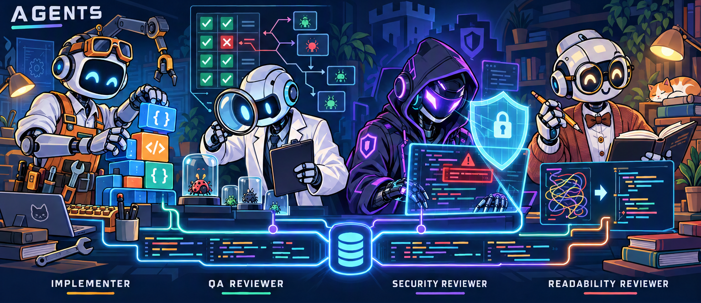

# Agents

- **Implementer:** Plans and delivers scoped changes, runs checks and coordinates independent reviews.
- **QA:** Reviews correctness and regression coverage; may add or modify tests only.
- **Security:** Reviews exploitable risks and unsafe defaults; read-only.
- **Readability:** Reviews clarity and unnecessary complexity; read-only.
